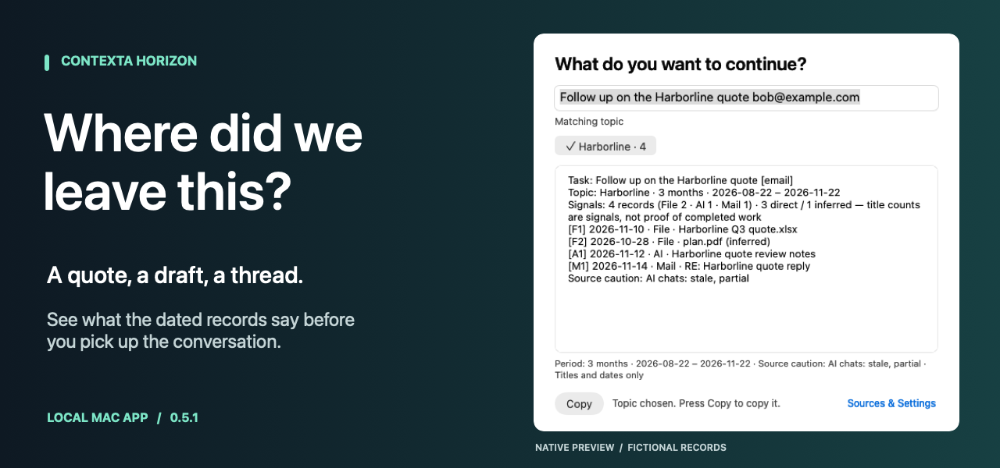

# Contexta Horizon for Mac

**Pick up the work, not just the file.** Horizon is a Mac menu bar app that brings dated references from files, earlier AI chats and mail into one short preview. Use it to answer a familiar question: *Where did we leave this?*

[Download for Apple Silicon](https://github.com/AgentChiChi/contexta-horizon/releases/download/v0.5.1/Contexta-Horizon-0.5.1-macOS-arm64.zip) · [Try the sample](GUIDE.md#try-it-with-fictional-mail) · [Release notes](https://github.com/AgentChiChi/contexta-horizon/releases/tag/v0.5.1)

**0.5.1 public preview** · Apple Silicon · macOS 13+ · Ad-hoc signed, **not Apple-notarized**. If your Mac blocks it, leave Gatekeeper on. See the [installation guide](GUIDE.md) or [build from source](#build-from-source).

## The file is easy to find. The unfinished question isn't.

On Friday you revised a quote. On Monday the spreadsheet is right there, but did the supplier actually confirm delivery? In the fictional Harborline example, the workbook is one clue; an email titled **“Harborline quote: confirm the sample delivery date”** is another. Its title tells you which thread to check. It does **not** tell you the supplier said yes.

That distinction is the point of Horizon: see **what you have evidence for**, and decide what to do next.

## Try it without connecting an account

1. Download the app above and the [fictional sample mailbox](https://github.com/AgentChiChi/contexta-horizon/releases/download/v0.5.1/sample-mail.mbox). The app starts empty if you have no local feeds.
2. In **Sources & Settings → Import…**, choose `sample-mail.mbox`. Return to the simple view and type **“Follow up on the Harborline quote.”**
3. Inspect the dates, titles and sources. Stop there, or click **Copy** and paste the preview into the chat you choose. If the sample looks empty, [adjust the period or regenerate it](GUIDE.md).

### Bring the context to the conversation you already use

- **ChatGPT or Claude:** Review in Horizon, then copy and paste. No provider login, connector, or automatic sending from the app.
- **Aside (optional):** Install the [account skill](Integrations/Aside/). Ask **“Where did we leave the Harborline quote?”** or **“지난번 견적 어디까지 했지?”** No wake word. When a lookup is needed, the references enter the current Aside chat and may be processed by its model. Say **“use only this chat”** to skip local lookup.

## What's better in 0.5.1

- **Less boilerplate when there's little to show.** Most one-to-three-record previews keep the dates and caveats without repeating the task. Small timing questions retain the fuller layout: the compact version made a test model invent a meeting time.
- **Fewer copies of the same clue.** Replies and numbered revisions no longer get first claim on every citation slot. An older exception can surface beside a newer update.
- **A request isn't a decision.** For status questions, wording that identifies a hold or a limit gets preference over routine titles like “approval agenda.” Titles remain references, never a verdict that work is complete.

**What we measured:** On six held-out fictional cases, the selected titles contained **10 of 10** target references, up from **9 of 10**. The small local model still answered only **2 of 4** separate benchmark tasks correctly. Better evidence selection is not a promise of a better answer. [Results, misses and evaluation method →](VERIFICATION.md)

## What stays on your Mac

The standalone app reads the local metadata and snapshots you make available. It does not crawl all your accounts, run a background model or send a prompt to an AI provider. Choose the period and source types yourself. A handoff contains dated titles, not full document bodies. A title can still be sensitive; review it before copying or using the Aside integration.

[English guide](GUIDE.md) · [Watch the 33-second walkthrough of the original copy flow (0.4.1)](https://github.com/AgentChiChi/contexta-horizon/blob/v0.4.1/Horizon-Walkthrough.mp4) · [Verify your download](https://github.com/AgentChiChi/contexta-horizon/releases/download/v0.5.1/SHA256SUMS.txt)

## Build from source

With Apple Command Line Tools installed, run `bash build.sh` from the repository root. It builds `dist/contexta-horizon.app` and checks synthetic fixtures. It does not install the app. No open-source license has been granted.
