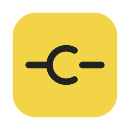
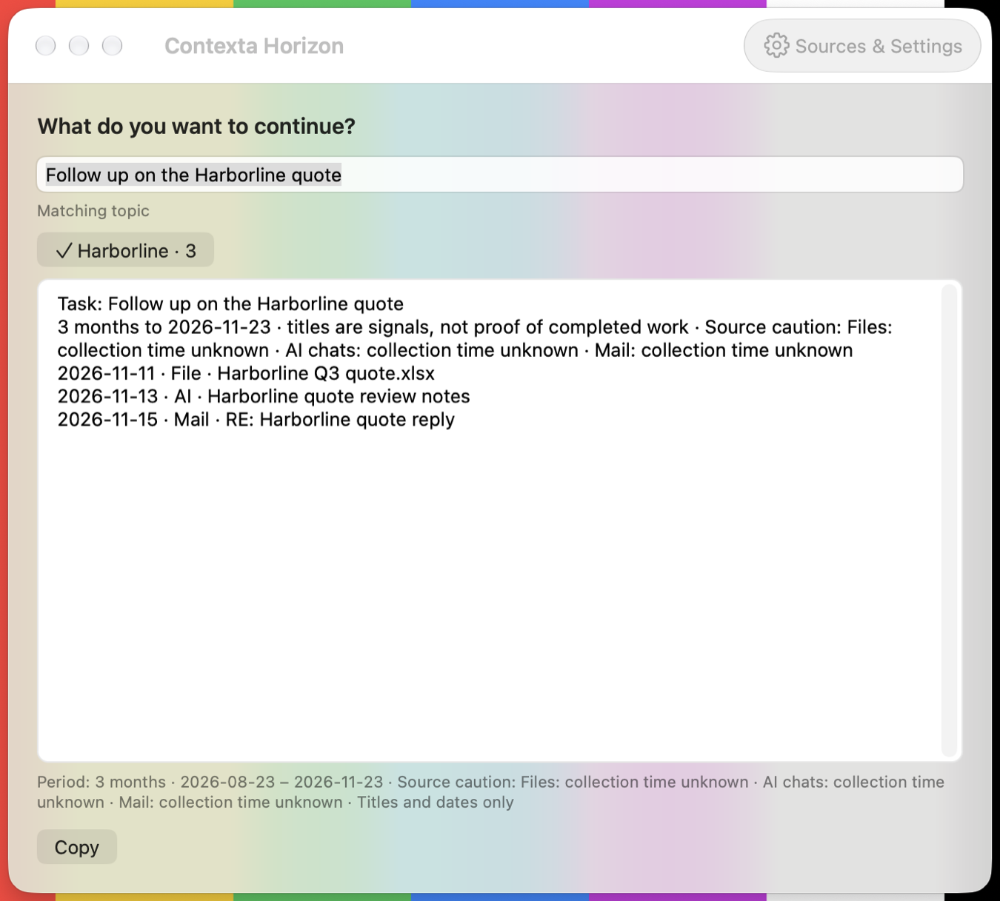

# Contexta Horizon for Mac

**New chat. Same project.** Pick up the thread in ChatGPT, Claude or Aside without pasting your entire history. Horizon brings dated references from your local file lists, earlier AI chats and mail into one Mac menu bar preview. You decide which conversation gets them.

**[Download for Apple Silicon](https://github.com/AgentChiChi/contexta-horizon/releases/download/v0.5.6/Contexta-Horizon-0.5.6-macOS-arm64.zip)** · [Get started](GUIDE.md) · [0.5.6 release](https://github.com/AgentChiChi/contexta-horizon/releases/tag/v0.5.6)

macOS 13+ · Apple Silicon · **Public preview, ad-hoc signed and not Apple-notarized.** If your Mac blocks it, leave Gatekeeper enabled. See the [installation guide](GUIDE.md).

### A Finder-style view for resuming work · 0.5.6

Review your task and the references side by side with familiar Mac controls: 13-point text in the search field, preview and lists, native toolbars, and 24-point list rows. Backgrounds softly pick up the colors behind each window; turning on **Reduce transparency** gives them a solid background. The preview stays readable in either mode.

[See the Sources & Settings window](docs/media/horizon-settings-0.5.6.png)

### The Index Yellow icon

Look for the yellow tile in Finder, like an index tab marking where you left off. The plate is Index Yellow (`#F4D447`), the mark is dark ink (`#20231F`), and the menu bar keeps its monochrome **-C-**: the left line meets Contexta’s C, and the line on the right picks up the thread. [Finder and menu bar icon previews](Icon/icon-preview.png) · [Vector source](Icon/mark.svg)

Open Horizon and start typing while your sources load. Reopening the window joins the read already in progress instead of starting over. In **Sources & Settings**, **Read Sources** replaces the two old read buttons. It starts with local sources; adding recent subjects and dates from an already-open Mail app requires your confirmation. [When Mail is offered](GUIDE.md#what-a-source-switch-does)

**Watch: New chat. Same project.** (39 seconds, filmed in 0.5.2; the icon and settings toolbar have since changed)

https://github.com/user-attachments/assets/4b900293-a088-4993-8a61-5ab2aa388ffa

[Download the MP4](https://raw.githubusercontent.com/AgentChiChi/contexta-horizon/main/docs/media/Horizon-0.5.2-Walkthrough.mp4) · [Try the fictional mailbox shown in the video](https://github.com/AgentChiChi/contexta-horizon/blob/v0.5.2/Demo/Harborline-Demo.mbox)

## “Did they approve the quote, or did we only send a draft?”

Your new chat hasn't seen Friday's work. You could paste the whole thread, or give it the clues that matter: a workbook called *Harborline Q3 quote.xlsx*, an earlier chat titled *Harborline quote review notes*, and a mail subject that says *Harborline contract draft for review*. That last title is a reason to **check the reply**, not a reason to tell a customer the deal is signed.

Horizon shows you the dates and source types. It doesn't read a contract and decide what happened. That's what makes the preview useful even if you never open an AI chat.

## Try it before sharing anything

1. Open Horizon on a fresh install. In the empty view with nothing typed, choose **Try a fictional example**. No sign-in, mailbox import or model needed for the demo.
2. Inspect the Harborline references, then choose **Exit example**. The demo lives in memory. **Copy is off**, and the example doesn't become one of your projects.
3. To try the actual handoff without personal data, import the [fictional mailbox](https://github.com/AgentChiChi/contexta-horizon/releases/download/v0.5.6/sample-mail.mbox) from **Sources & Settings → Import…**. Return to the simple view and type **“Follow up on the Harborline quote.”**

### Two ways to resume work

**ChatGPT or Claude:** Review the real or imported references, click **Copy**, then paste them into the chat you choose. A useful next prompt:

> Using only these dated titles, tell me what was last documented, what is still unknown, and which record I should open before replying. Cite the title and date. Don't treat a request as confirmation.

**Aside:** With the [optional account skill](Integrations/Aside/), ask **“Where did we leave the Harborline quote?”** There's no wake word. If a local lookup is needed, the references enter your current Aside chat and may be processed by its model. Use the manual Copy route if you want to inspect every title first.

## What changes when you turn a source off?

In 0.5.1, switching a source off filtered the result after the feeds were read. Since **0.5.2**, a new lookup doesn't open a disabled file, chat or mail feed. Imports may mix chat and mail records, so the entire imports folder is skipped unless **Imports, AI chats and Mail** are all on. Skipped doesn't mean empty. A manual file import is separate; collecting new items from Mail requires opting in under Read Sources. [Details and limits](GUIDE.md#what-a-source-switch-does)

## What we tested

- **50 of 50** simulated reopens returned before a delayed local read finished. Reopening five times started one read in 0.5.3, versus six in 0.5.2; the typed task stayed intact.
- Build 13 passed **66/66** synthetic app checks and **21/21** static checks. Native-window checks covered clipping, title bars, transparency and copy behavior. No personal mailbox was tested.
- The application ZIP contains the tested executable and the ten-size Finder icon. The menu bar uses the same path as an 18-point macOS template.

These checks measure app behavior, not AI answer quality. [Verification and limits](VERIFICATION.md)

### Build from source

With Apple Command Line Tools installed, run `bash build.sh` from the repository root. The script builds `dist/contexta-horizon.app` and runs synthetic checks; it doesn't install the app. No open-source license has been granted.
