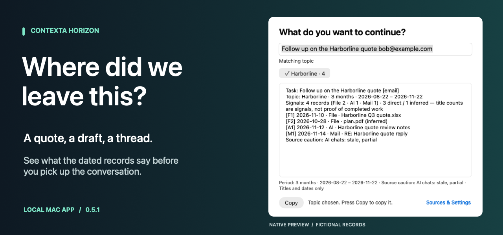

## Pick up where the evidence left off

You found the quote. Did the supplier confirm delivery, or did someone only ask? Horizon puts the dated file, chat and mail titles together so you know which thread to reopen before promising a date.

**[Download the Mac app](https://github.com/AgentChiChi/contexta-horizon/releases/download/v0.5.1/Contexta-Horizon-0.5.1-macOS-arm64.zip)** · [English guide](https://github.com/AgentChiChi/contexta-horizon/blob/v0.5.1/GUIDE.md) · [한국어 사용법](https://github.com/AgentChiChi/contexta-horizon/blob/v0.5.1/GUIDE.ko.md)

Apple Silicon · macOS 13+ · **Public preview, ad-hoc signed and not notarized.** Keep Gatekeeper enabled. The ZIP above is the application, not GitHub's automatic source archive.

### Start with a fictional project

1. Unzip the app and follow the installation guide. No personal data is needed for this demo.
2. Download **[sample-mail.mbox](https://github.com/AgentChiChi/contexta-horizon/releases/download/v0.5.1/sample-mail.mbox)**. Open **Sources & Settings → Import…**, choose the mailbox and return to the simple view.
3. Type **“Follow up on the Harborline quote.”** Review the dated records; click **Copy** only if you want to paste them into ChatGPT or Claude. Sample too old for your current period? The guide explains how to bring it into view.

### What's new since 0.4.1

- **Resume naturally in Aside.** Install the optional [Aside skill](https://github.com/AgentChiChi/contexta-horizon/blob/v0.5.1/Integrations/Aside/README.md) and ask “지난번 견적 어디까지 했지?” No product name required. Local references enter the current chat only when looked up; the standalone copy flow is unchanged.
- **Use the six references for different clues.** Reply chains and numbered revisions leave room for an older exception; status questions favor concrete limits and pending decisions over generic approval titles.
- **Keep small handoffs proportionate.** Shorten predictable boilerplate, except for small timing questions where a fuller date layout was safer in our test.

### Checked, not promised

58/58 synthetic app checks and 16/16 static checks passed. The actual window and Aside lookup returned byte-identical text on the checked fixture. Held-out target references improved from 9/10 to 10/10; final-answer accuracy on a separate four-task local-model test remained 2/4. [Read the verification notes](https://github.com/AgentChiChi/contexta-horizon/blob/v0.5.1/VERIFICATION.md).

**Assets:** Mac application ZIP · optional Aside skill ZIP · fictional sample mailbox · SHA-256 checksums. No personal files or live mail are included.
