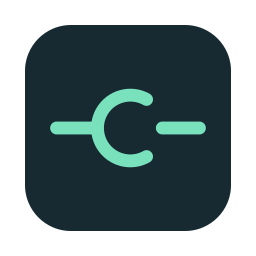

## Pick up the thread

Look for **-C-** in your menu bar. The line meets Contexta’s C on the left and resumes on the right: a new chat doesn’t have to mean a new project. Finder uses the mint-on-ink version; the menu bar uses the same mark in a single color.

**[Download the Mac app](https://github.com/AgentChiChi/contexta-horizon/releases/download/v0.5.3/Contexta-Horizon-0.5.3-macOS-arm64.zip)** · [English guide](https://github.com/AgentChiChi/contexta-horizon/blob/v0.5.3/GUIDE.md) · [Verification](https://github.com/AgentChiChi/contexta-horizon/blob/v0.5.3/VERIFICATION.md)

**0.5.3, build 10** · Apple Silicon · macOS 13+ · Ad-hoc signed, **not Apple-notarized**. Keep Gatekeeper enabled. Use the app ZIP above, not the automatic source archive.

- **One Read Sources button.** Read enabled local sources, and optionally include recent subjects and dates from an already-running Mail app. A confirmation appears only when Imports, AI chats and Mail are all on. Local Sources Only is the default. Importing an export remains separate.
- **Start typing while the app reads.** Both windows show progress. Reopen the window without starting the same read again or losing the task you typed.
- **Try it without connecting anything.** Choose **Try a fictional example** on an empty install, or use the [sample mailbox](https://github.com/AgentChiChi/contexta-horizon/releases/download/v0.5.3/sample-mail.mbox) to practice copying a reviewed handoff. The [39-second video](https://github.com/AgentChiChi/contexta-horizon#contexta-horizon-for-mac) shows the workflow in 0.5.2, before the icon and settings toolbar changed.

Build 10 passed 64 synthetic self-tests, 19 static checks and 63 native-window smoke steps. Mail interactions were mocked, not tested against a live mailbox. The app ZIP, optional Aside skill, fictional mailbox and SHA-256 checksums are attached below.
