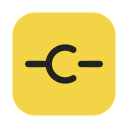

## An index tab for the work you want to resume

The Finder icon now pairs **Index Yellow `#F4D447`** with a **dark `#20231F` mark**. The `-C-` shape is unchanged. In the menu bar it remains monochrome, so macOS can tint it for the current appearance. **This is a palette-only update**: the Read Sources button, Mail consent, imports and reviewed copy flow work as in 0.5.3.

**[Download the Mac app](https://github.com/AgentChiChi/contexta-horizon/releases/download/v0.5.4/Contexta-Horizon-0.5.4-macOS-arm64.zip)** · [English guide](https://github.com/AgentChiChi/contexta-horizon/blob/v0.5.4/GUIDE.md) · [Icon previews](https://github.com/AgentChiChi/contexta-horizon/blob/v0.5.4/Icon/icon-preview.png)

0.5.4 build 11 · Apple Silicon · macOS 13+ · Ad-hoc signed and **not Apple-notarized**. Keep Gatekeeper enabled. The ZIP above is the application, not GitHub’s automatic source archive.

Also attached: optional Aside skill, fictional sample mailbox, and SHA-256 checksums. [Verification notes](https://github.com/AgentChiChi/contexta-horizon/blob/v0.5.4/VERIFICATION.md).
