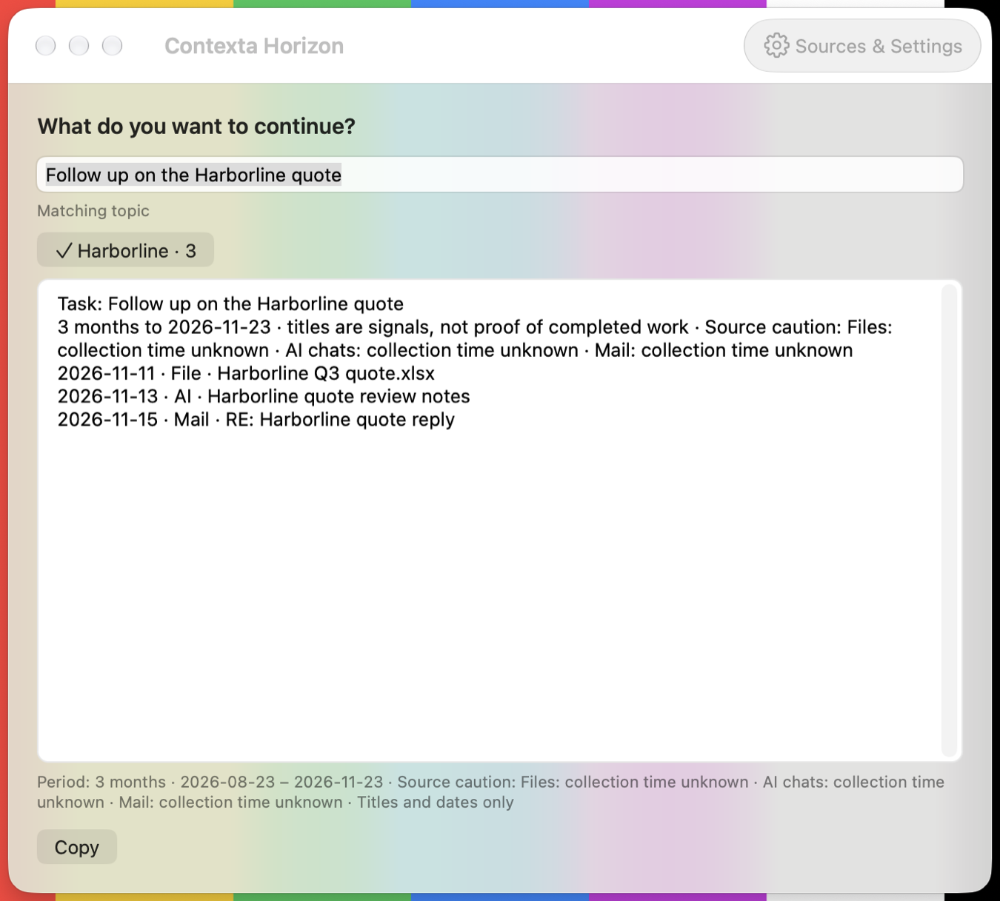

**[Download Contexta Horizon for Apple Silicon](https://github.com/AgentChiChi/contexta-horizon/releases/download/v0.5.6/Contexta-Horizon-0.5.6-macOS-arm64.zip)** · [Installation guide](https://github.com/AgentChiChi/contexta-horizon/blob/v0.5.6/GUIDE.md)

The handoff stays the same: review dated references, then copy only when you're ready. This update makes both windows feel more like Finder.

- **Easier to scan:** search, preview and list text use the Mac’s regular system font (13 pt on the test Mac). The two lists use 11 pt headers and 24 pt rows.
- **Actions in the title bar:** open **Sources & Settings** from the search window’s toolbar. The settings toolbar holds the period, **Read Sources**, **Import…** and **Refresh Feeds…**.
- **Subtle window backgrounds:** light and dark windows pick up colors from behind them while the preview and lists stay solid. With macOS **Reduce transparency** on, both window backgrounds become solid too.

Build 13 · Apple Silicon · macOS 13+ · Ad-hoc signed, **not Apple-notarized**. Keep Gatekeeper enabled. The optional Aside skill, fictional sample mailbox and SHA-256 checksums are attached separately. [Verification and limits](https://github.com/AgentChiChi/contexta-horizon/blob/v0.5.6/VERIFICATION.md).
